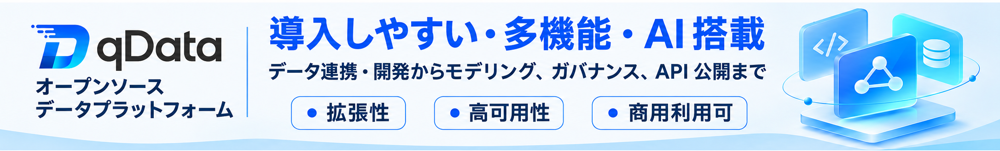

  
 
 
 
 

 
 
 

  <a href="README.zh-CN.md">📖简体中文</a> | <a href="README.md">📖English</a> | 📖日本語

## プラットフォーム概要

**軽量で使いやすく、必要な機能を一通り備えた AI ネイティブなデータ基盤です。個人でも手軽に始められ、企業の本番環境にも導入できます。**

qData は、企業のデータチームや個人開発者向けのオープンソースのデータ基盤です。**データ連携、データパイプライン開発、データモデリング、データガバナンス、データカタログ、API 公開、AI による分析**を一つの環境で行えます。データの取り込みから加工、整理、管理、共有までを支援します。

個人での開発や技術検証から、企業のデータプロジェクト、日々の開発、本番運用まで利用できます。個人のデータ処理や、企業での業務へのデータ活用を支援します。

✨✨✨**ドキュメント**✨✨✨ <a href="https://docs.qdata.tech/ja/qData/" target="_blank">https://docs.qdata.tech/ja/qData/</a>

✨✨✨**オープンソース版デモ**✨✨✨ <a href="https://demo.qdata.tech" target="_blank">https://demo.qdata.tech</a>（ユーザー名 `qData`、パスワード `qData123`）

✨✨✨**プロフェッショナル版デモ**✨✨✨ <a href="https://pro-demo.qdata.tech" target="_blank">https://pro-demo.qdata.tech</a> · [デモ用アカウントのお申し込み](https://docs.qdata.tech/ja/business/policy.html)

> qData が役に立ったら、リポジトリに **スター ⭐️** を付けていただけると、継続開発の励みになります。🚀

qData は Apache License 2.0 に qData 固有の追加条件を加えて提供されます。詳しくは [LICENSE](LICENSE) と[商用利用の案内](#license-and-services)をご覧ください。

## 主な特長

### 1 台から始め、必要に応じて拡張

**1 台で動作するセルフホストの標準構成と、処理規模に応じた拡張構成**を選べます。標準構成では、qData 1 インスタンス、SeaTunnel Zeta 1 ノード、DolphinScheduler Standalone、MySQL、Redis を使い、1 台でデータ処理ジョブを実行できます。

### データ同期から本番運用までの ETL パイプライン開発

**データ同期、スクリプト開発、ワークフロー管理、スケジューリング、運用**を一つの環境で行えます。テーブル単位またはデータベース全体をバッチ転送・リアルタイム同期でき、**RDS SQL、Doris SQL、シェルスクリプト**で処理を記述できます。テンプレートの再利用、依存関係の設定、実行監視、失敗時の再実行により、ジョブを効率よく開発し、安定して運用できます。

### 業務領域の整理からモデル公開までのデータウェアハウス設計

業務領域とデータウェアハウス（DWH）のレイヤーを整理し、論理データモデルと業務指標を定義して公開できます。モデル、指標、データ標準をまとめて管理することで、データ構造と業務上の定義をそろえ、モデルを再利用しやすくします。

### データ活用の全工程を支える AI ネイティブ機能

自然言語での対話、AI による生成や分析を通じて、**パイプライン開発、ジョブ設定、運用、データ分析**を支援します。データについて自然言語で質問すると、**SQL（Text-to-SQL）、グラフ、分析結果の要約**が生成され、データを調べて理解するのに役立ちます。

### データの取り込みから業務利用まで

データ処理、ガバナンス、データカタログ、API による共有を一つの環境で扱えます。プロジェクトごとの作業領域、メンバーのロール、システム管理機能を備えており、チームでデータの取り込みから加工、管理、利用まで進められます。

### 機能と構成を用途に合わせて拡張

モジュール構成を採用し、データソース用のコネクター、業務モジュール、クレンジングや品質チェックのルールを拡張できます。SQL、シェルスクリプト、タスクテンプレートで処理を再利用し、処理量に合わせて実行環境とスケジューラーを拡張できます。

### 複数インスタンスとクラスタ構成による高可用性

本番で高い可用性が必要な場合は、qData を複数インスタンスで稼働させ、SeaTunnel Zeta と DolphinScheduler をクラスタ構成にできます。ジョブの監視、実行ログ、再実行、同期の復旧機能を使って、障害を調査し、対応できます。

## クイックスタート

### オンラインデモを試す

[qData オープンソース版のデモ](https://demo.qdata.tech)を開くと、インストールせずに製品を試せます。

**ユーザー名 `qData`　パスワード `qData123`**

まずパイプライン開発とデータモデリングを試し、その後でデータカタログ、データ API、自然言語による問い合わせを確認すると、データの準備から利用までの流れが分かります。

### インストール方法を選ぶ

- **[Docker Compose で起動](https://docs.qdata.tech/ja/qData/deploy/docker-compose-deployment.html)** — ローカル環境を設定して起動し、すぐに試したり導入したりできます。
- **[ソースコードから起動](https://docs.qdata.tech/ja/qData/deploy/build-from-source.html)** — フロントエンドとバックエンドの開発環境を起動し、改修や機能拡張を行えます。
- **[手動でインストール](https://docs.qdata.tech/ja/qData/deploy/manual-deployment/)** — 既存のインフラや独自の構成に合わせて、各サービスを個別に導入・管理できます。

動作要件、インストール手順、各コンポーネントの設定、よくある質問は[導入ガイド](https://docs.qdata.tech/ja/qData/deploy/deploy-open-source.html)をご覧ください。

## 製品の機能構成

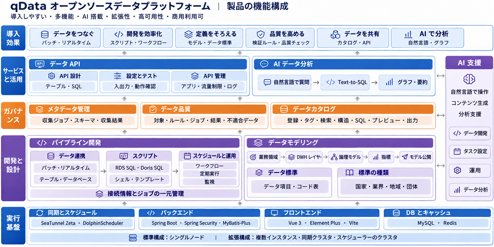

## 画面イメージ

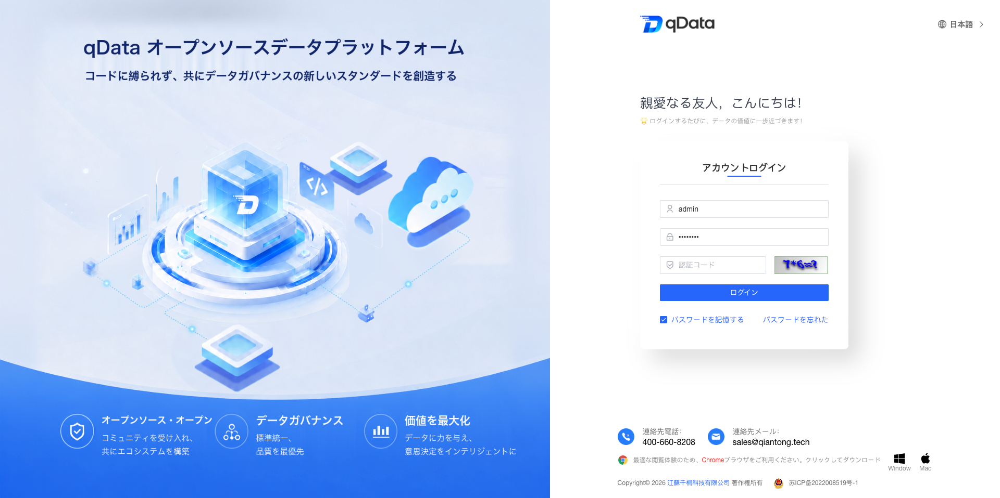

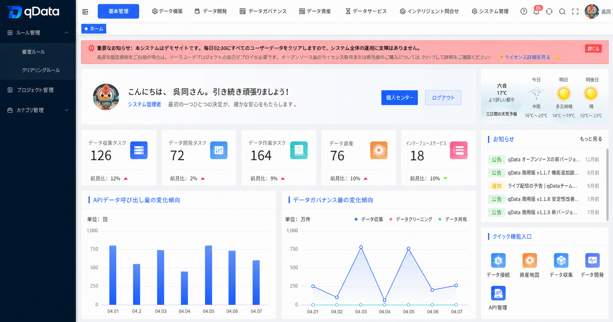

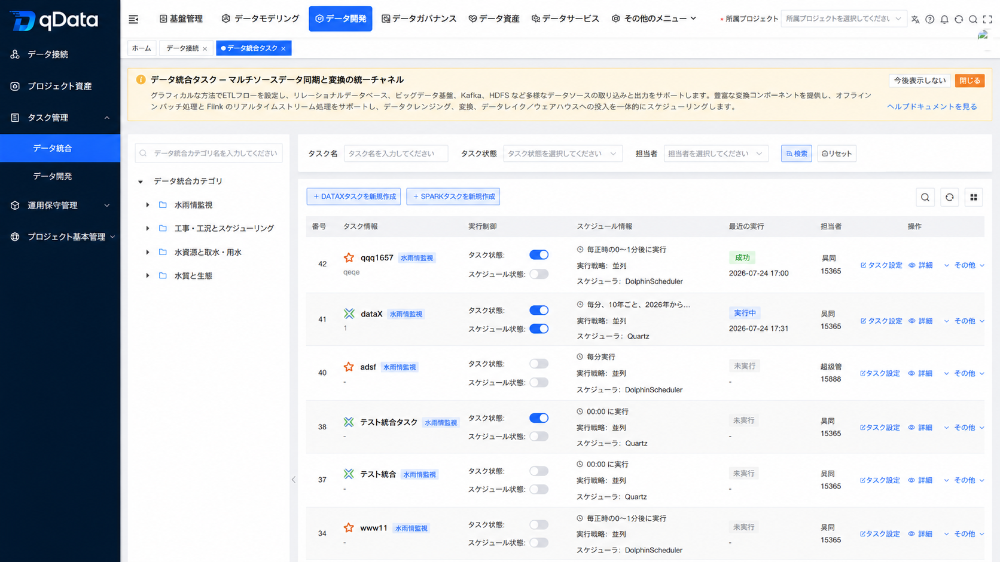

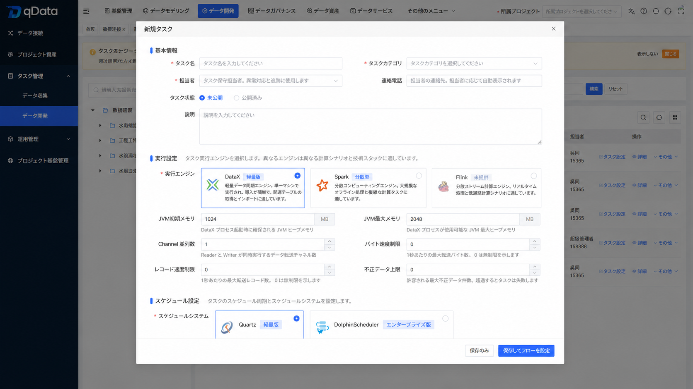

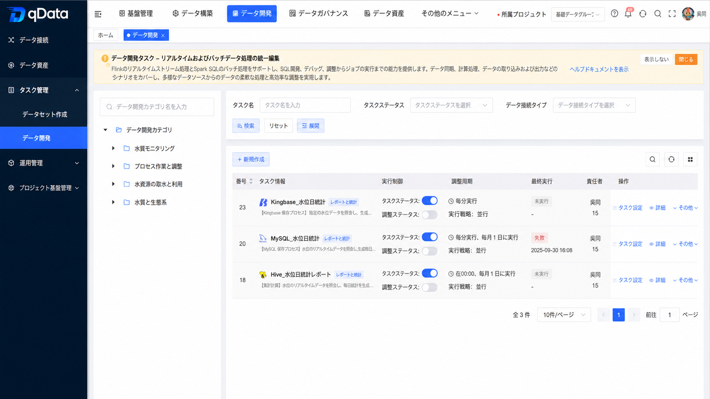

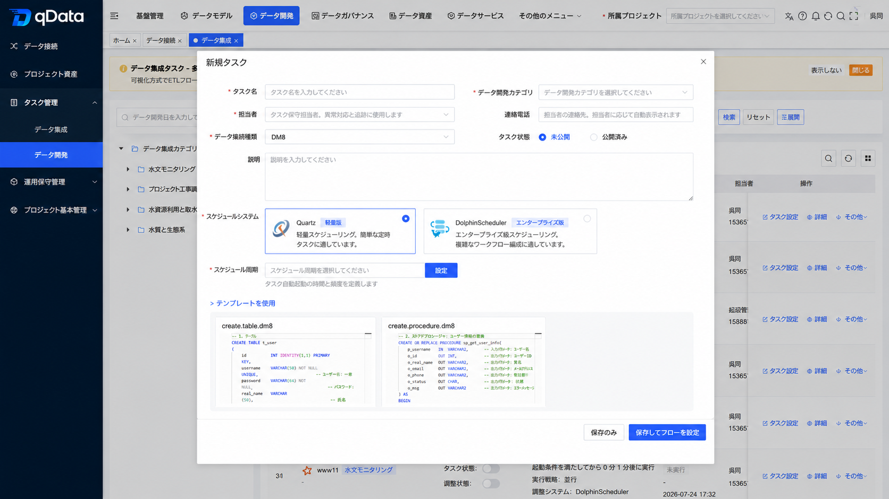

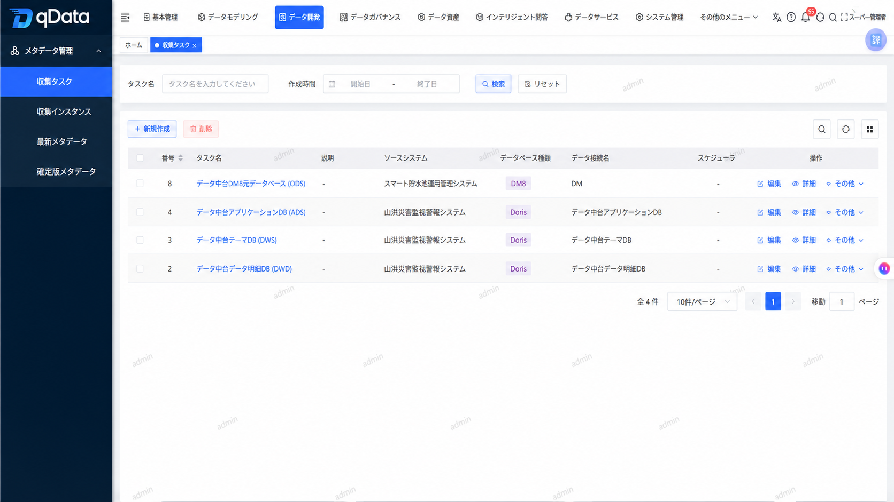

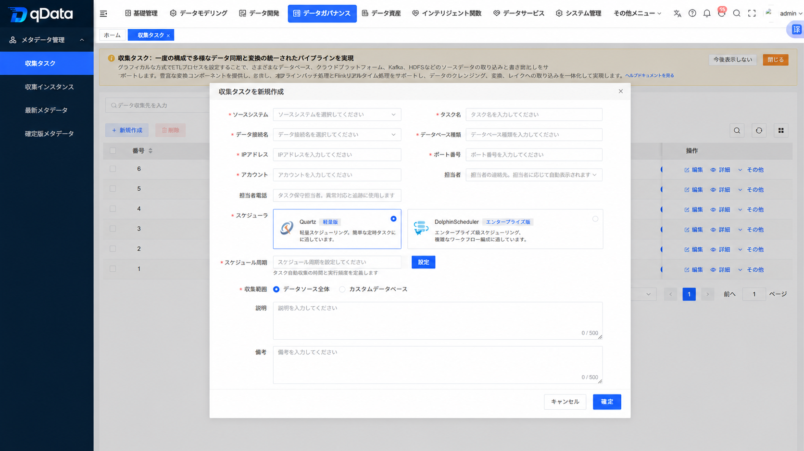

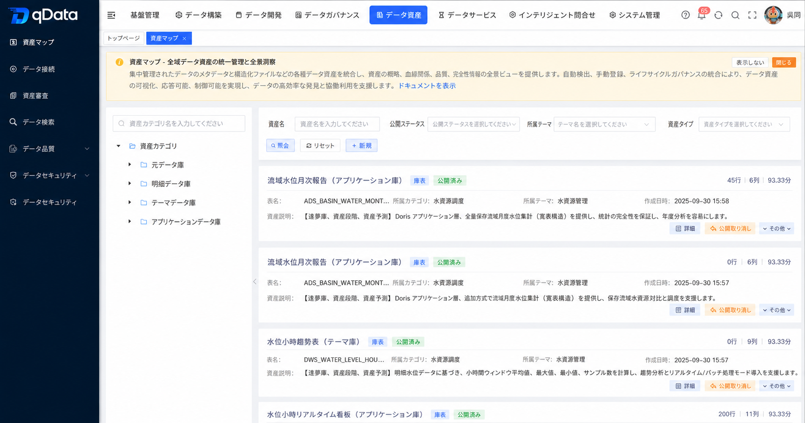

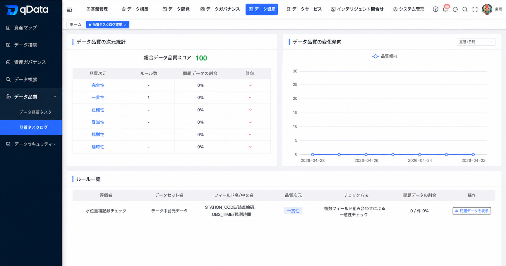

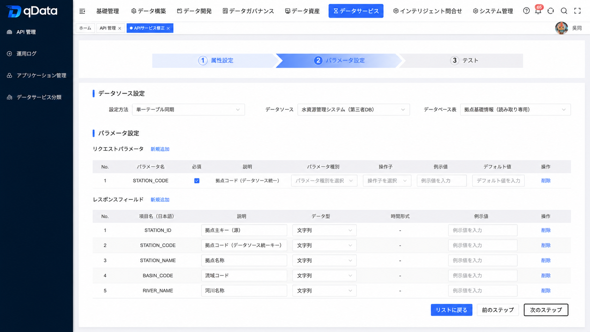

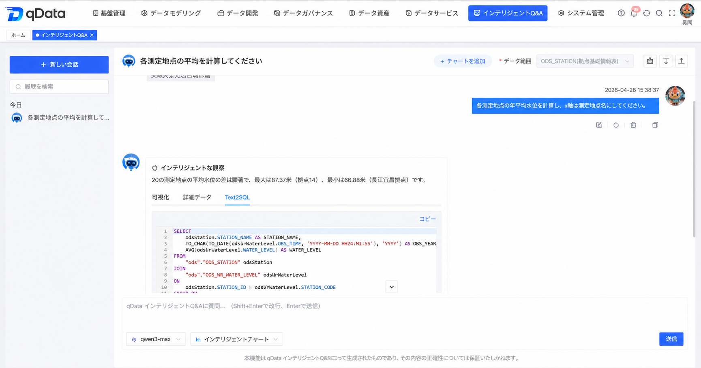

## 機能概要

| 主な機能 | 特長 |
| --- | --- |
| **30 種類以上の異種データソース** | 広く利用されているデータベース、中国で開発されたデータベース、データウェアハウス、メッセージキュー、ファイルストレージに対応し、異なるシステム間でデータを連携できます。 |
| **幅広い用途に対応するデータ連携** | バッチ同期、リアルタイムの変更データキャプチャ（CDC）、データベース全体の同期に対応します。全件・差分の転送や、異なるデータベース間での移行が可能です。 |
| **データ開発から本番運用まで一元化** | ETL、SQL 開発、DAG ワークフロー、cron スケジューリング、ジョブ運用を一つのプラットフォームに統合します。 |
| **企業向け DWH モデリング** | ODS、DIM、DWD、DWS、ADS の 5 層構成に対応します。論理データモデル、指標体系、データ標準を組み合わせ、一貫性のある DWH を構築できます。 |
| **全工程をカバーするデータガバナンス** | メタデータ管理、データ標準、品質チェック、データリネージを統合し、データの発見から品質管理まで一貫して対応します。 |
| **データ資産の活用と API 公開** | データ資産のカタログ化、高度な検索、SQL クエリ、API サービスとしての公開を一元化します。 |
| **AI エージェントによるデータ開発・分析支援** | AI エージェントとアシスタントがデータ開発を支援します。自然言語でのデータへの問い合わせ、SQL の自動生成、グラフによる分析、データからの知見の抽出が可能です。 |

機能の詳細、対応するデータソース、エディションごとの提供範囲は[機能比較表](https://docs.qdata.tech/ja/qData/pro/features.html)をご覧ください。

## 小規模構成から本番運用まで

個人での開発、技術検証、日常的なデータ処理は小規模な構成から始められます。企業での利用では、処理量や可用性の要件に合わせ、複数インスタンスやクラスタ構成に拡張できます。

| コンポーネント | 小規模向けの標準構成 | 本番環境での拡張構成 |
| --- | --- | --- |
| **qData** | 1 インスタンス | 複数インスタンスで高可用性に対応 |
| **SeaTunnel Zeta** | シングルノードで同期ジョブを実行 | 分散クラスタで処理能力を拡張 |
| **DolphinScheduler** | Standalone 構成でジョブをスケジューリング | クラスタ構成でスケジューリングと実行能力を拡張 |
| **MySQL** | アプリケーションのデータを保存 | 本番の要件に合わせて冗長化 |
| **Redis** | キャッシュ | 本番の要件に合わせて冗長化 |
| **ZooKeeper** | 個別の導入は不要 | クラスタ構成に応じて導入 |

用途に応じて Flink や Spark などの処理エンジンを連携できます。対象タスクの種類や提供範囲は[機能比較表](https://docs.qdata.tech/ja/qData/pro/features.html)をご覧ください。

標準構成は、導入や保守の手間とリソース消費を抑えます。拡張構成では、より多くの処理と高い可用性に対応できます。利用規模や運用段階に合わせて構成を選べます。

## 開発と拡張

qData はフロントエンドとバックエンドを分離したモジュール構成を採用しています。コードを把握しやすく、業務システムとの連携や機能拡張が行えます。

| レイヤー | 主な技術 |
| --- | --- |
| バックエンド | Spring Boot、Spring Security、MyBatis-Plus |
| フロントエンド | Vue 3、Element Plus、Vite |
| 標準の同期・スケジューリング | SeaTunnel Zeta、DolphinScheduler |
| アプリケーションの DB・キャッシュ | MySQL または DM8（Dameng 8）、Redis |
| 追加できる処理エンジン | Flink、Spark など、必要に応じて連携 |

はじめに、業務用スクリプトの追加、タスクテンプレートの再利用、クレンジングや品質チェックのルールの拡張などを行えます。業務モジュールやデータソース用コネクターのカスタマイズも可能です。開発環境の準備と起動手順は[ソースコードからの起動ガイド](https://docs.qdata.tech/ja/qData/deploy/build-from-source.html)をご覧ください。

## ライセンスと商用サービス

qData は **Apache License 2.0 に qData 固有の追加条件を加えて**提供され、商用利用が可能です。[LICENSE](LICENSE) に従い、所定のロゴ、著作権表示、ライセンス表示、クレジット表記を保持してください。

所定のロゴや表示の削除・変更、ホワイトラベル化、OEM 提供、リブランディングを行う場合は、別途商用ライセンスを取得してください。ブランドのカスタマイズ、プロフェッショナル版、技術サービスについては[商用利用の案内](https://docs.qdata.tech/ja/business/policy.html)をご覧ください。

## ミッションとビジョン

**開発者や企業が、データ活用に必要な機能を無理のない費用で使えるようにすること。**

テクノロジーを扱いやすくし、データへの信頼を高め、アプリケーションを実際の業務で使えるようにすることが大切だと考えています。qData は、オープンソースで開発者の知見を集め、AI でデータ処理の負担を減らし、個人のアイデアを形にしたり、企業が日々の業務にデータを活用したりできる環境を提供します。

コミュニティとともに、長く使い続けられ、必要に応じて拡張できるデータ基盤を育てます。より多くの人が自分でデータを扱い、それを新しい取り組みにつなげられるようにすることが目標です。
