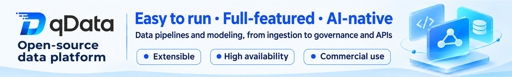

  
 
 
 
 

 
 
 

  <a href="README.zh-CN.md">📖简体中文</a> | 📖English | <a href="README.ja-JP.md">📖日本語</a>

## Platform overview

**Lightweight, easy to use, full-featured, and AI-native. Get started on your own or deploy in production with your team.**

qData is an open-source data platform for enterprise data teams and individual developers. It brings together **data integration, data pipeline development, data modeling, data governance, a data catalog, data APIs, and AI-assisted analytics**. It covers the data workflow from ingestion and transformation to organization, governance, and sharing.

Use qData for individual development and evaluation, enterprise data projects, and day-to-day development and production operations. It helps individual developers run real data workloads and teams put data to use in business applications.

✨✨✨**Documentation**✨✨✨ <a href="https://docs.qdata.tech/en/qData/" target="_blank">https://docs.qdata.tech/en/qData/</a>

✨✨✨**Open-Source Edition demo**✨✨✨ <a href="https://demo.qdata.tech" target="_blank">https://demo.qdata.tech</a> (username `qData`, password `qData123`)

✨✨✨**Professional Edition demo**✨✨✨ <a href="https://pro-demo.qdata.tech" target="_blank">https://pro-demo.qdata.tech</a> · [Request a demo account](https://docs.qdata.tech/en/business/policy.html)

> If qData is useful to you, give the repository a **star ⭐️**! 🚀

qData is available under the Apache License 2.0 with additional qData terms. See [LICENSE](LICENSE) and [commercial licensing](#license-and-services).

## Key features

### Start on one machine and scale as needed

qData supports **self-hosted deployment on one machine or as a scaled-out setup**. The default setup runs one qData instance, single-node SeaTunnel Zeta, DolphinScheduler Standalone, MySQL, and Redis. You can run data jobs with all of these components on one machine.

### Build and operate ETL pipelines, from sync to production

Handle **data synchronization, script development, workflow orchestration, scheduling, and operations** in one place. Sync individual tables or entire databases in batch or in real time, and write tasks in **RDS SQL, Doris SQL, or shell scripts**. Reuse templates, set task dependencies, monitor runs, and retry failures to make data jobs easier to build and more reliable to run.

### Data warehouse modeling from business planning to model publishing

Plan business domains and warehouse layers, define logical models and business metrics, and publish the models. Managing models, metrics, and data standards together keeps data structures and business definitions consistent and makes models easier to reuse.

### AI-native assistance across the data workflow

Use natural-language interaction, AI-assisted generation, and analysis across **pipeline development, task setup, operations, and data analysis**. Ask questions in plain language and get **generated SQL (text-to-SQL), charts, and written insights** to help you query and understand your data.

### From data ingestion to business use in one platform

Build data pipelines, govern data, manage the data catalog, and share datasets and APIs in one platform. Project workspaces, member roles, and system administration help teams manage the full workflow from ingestion and transformation to everyday use.

### Extend functionality and scale deployment

The modular architecture lets you extend data source connectors, application modules, cleansing rules, and data quality checks. Reuse business logic through SQL, shell scripts, and task templates. Scale job execution and scheduling as workloads grow.

### High availability with multiple instances and clusters

For production workloads that need higher availability, run multiple qData instances and deploy SeaTunnel Zeta and DolphinScheduler in clusters. Monitor runs and use execution logs, retries, and sync recovery to diagnose and recover from failures.

## Quick start

### Try the live demo

Open the [qData Open-Source Edition demo](https://demo.qdata.tech) to explore the product in your browser.

**Username `qData` · Password `qData123`**

Start with pipeline development and data modeling. Then explore the data catalog, data APIs, and natural-language queries to see how data goes from preparation to use.

### Choose a deployment method

- **[Docker Compose](https://docs.qdata.tech/en/qData/deploy/docker-compose-deployment.html)** — Set up and start a local environment for evaluation or deployment.
- **[Run from source](https://docs.qdata.tech/en/qData/deploy/build-from-source.html)** — Start the frontend and backend for development and extensions.
- **[Manual deployment](https://docs.qdata.tech/en/qData/deploy/manual-deployment/)** — Install and manage each service on existing infrastructure or with a custom configuration.

See the [deployment guide](https://docs.qdata.tech/en/qData/deploy/deploy-open-source.html) for requirements, installation, configuration, and troubleshooting.

## Product architecture

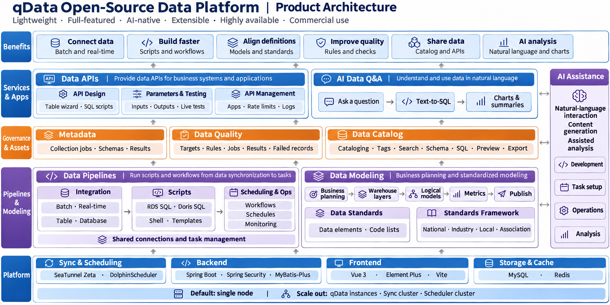

## Screenshots

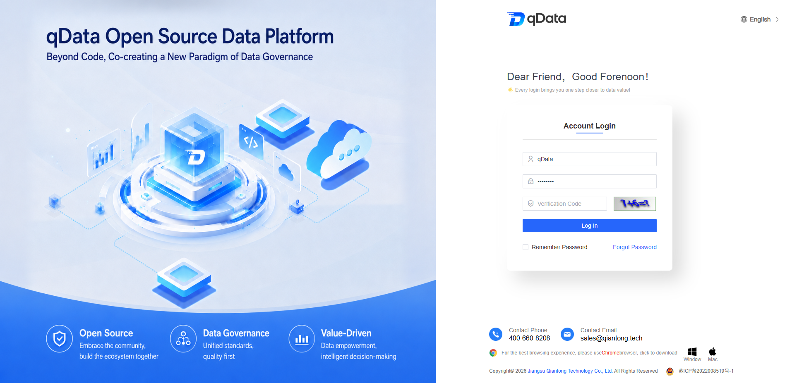

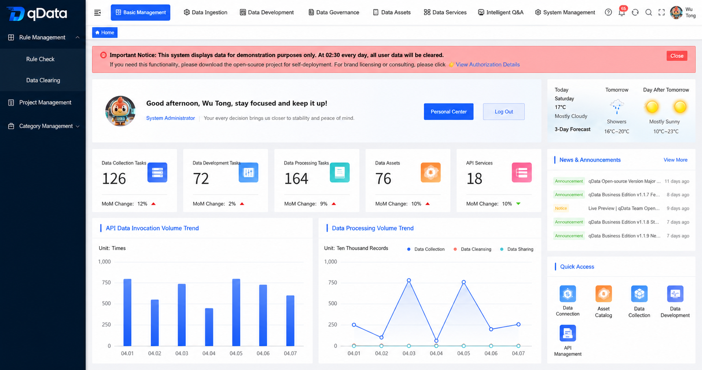

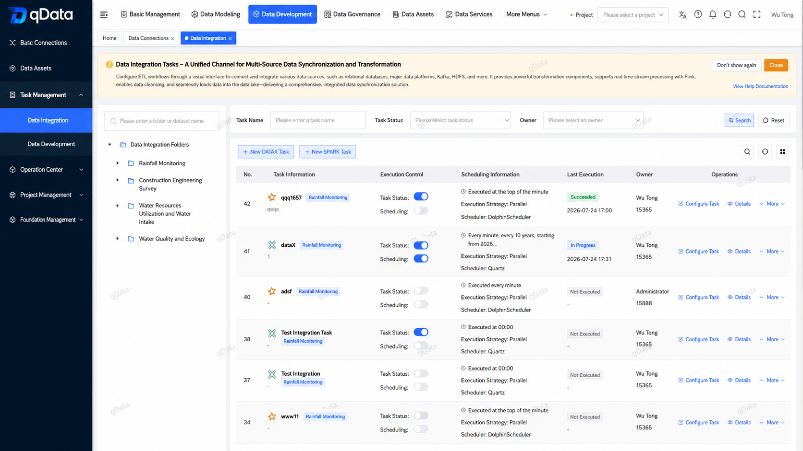

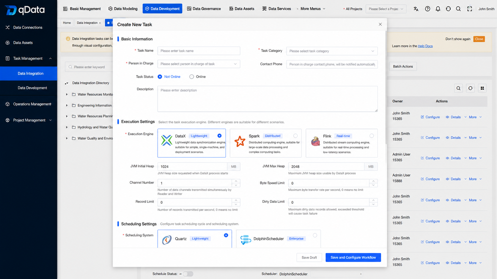

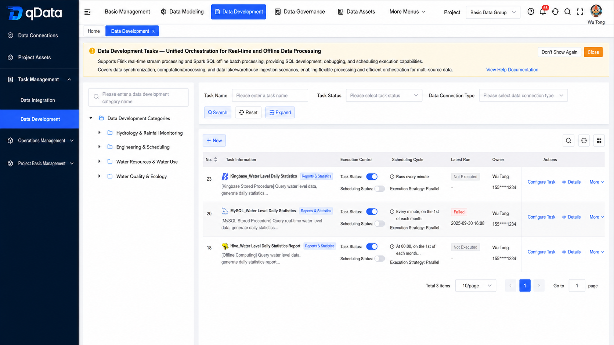

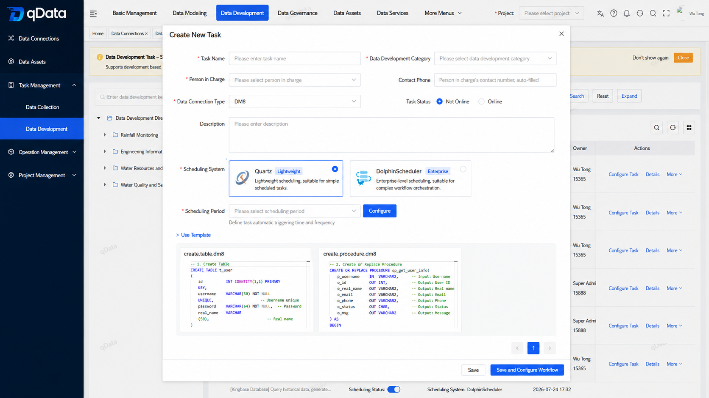

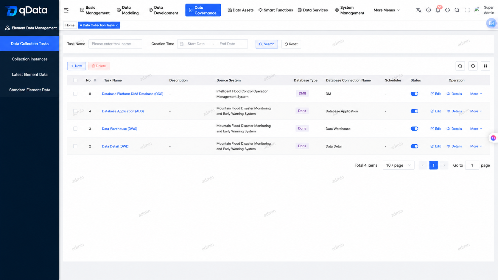

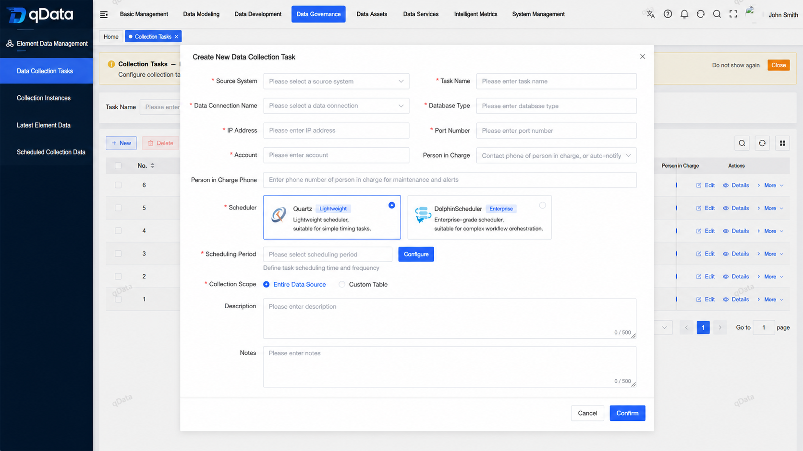

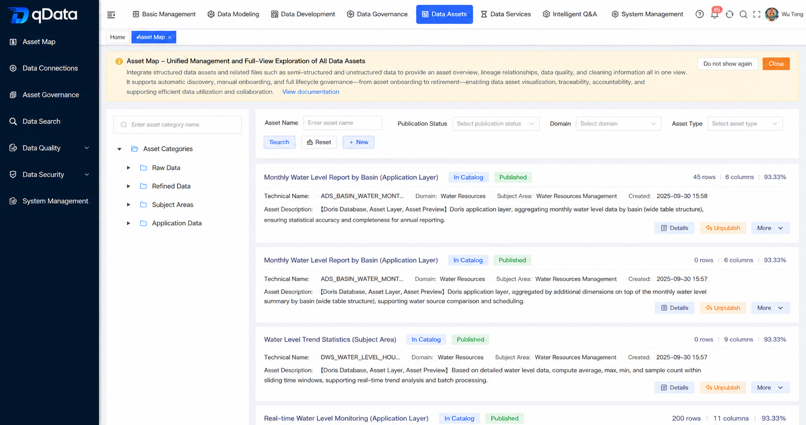

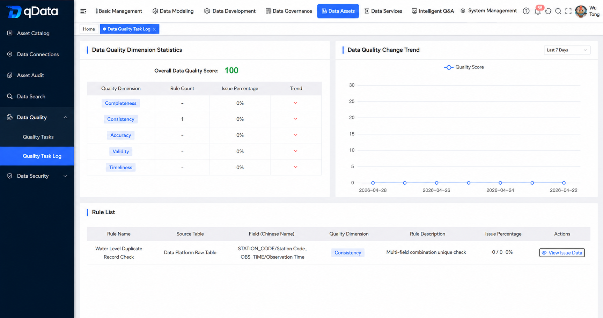

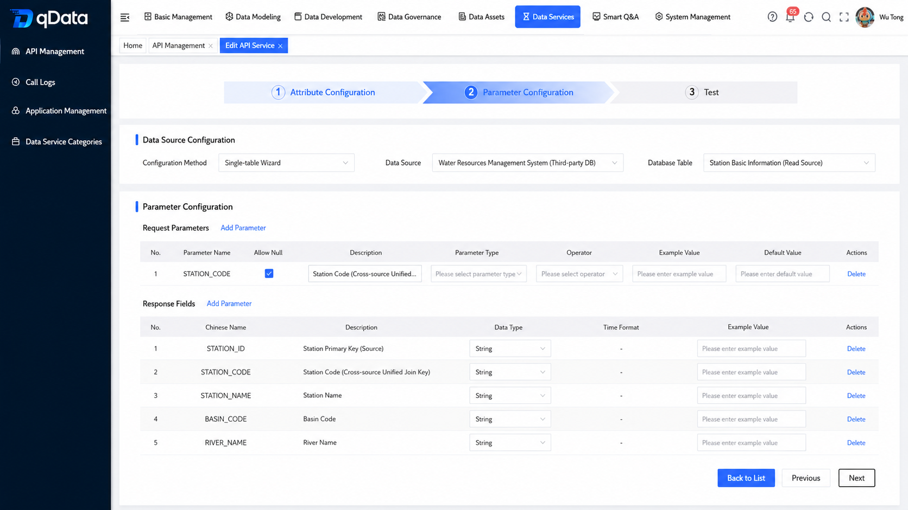

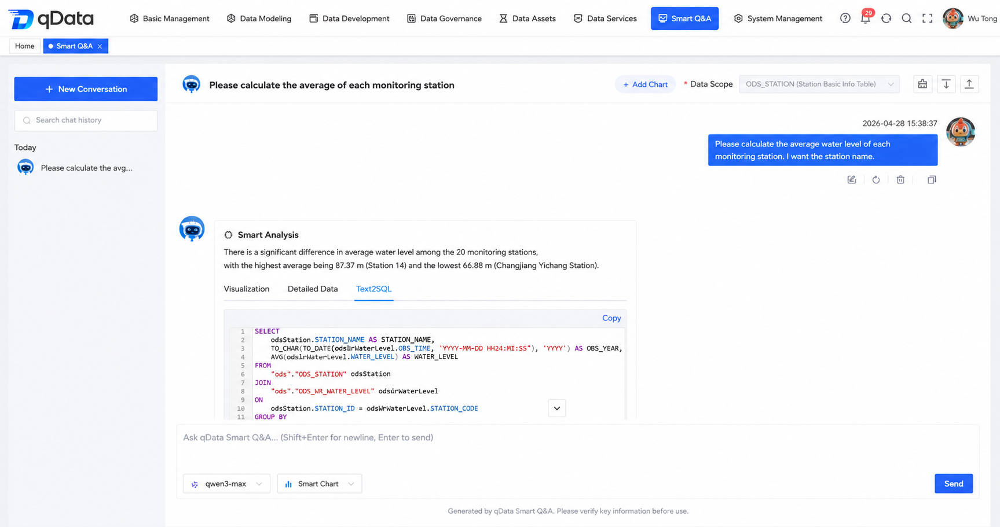

## Capabilities overview

| Capability | What you can do |
| --- | --- |
| **Data integration and sync** | Configure source and destination connections. Sync individual tables or entire databases in batch or in real time. |
| **SQL transformations and shell tasks** | Clean, transform, join, and aggregate data or call external programs. Use SQL for relational databases (RDS SQL), Doris SQL, or shell scripts. Reuse templates, pass runtime parameters, and inspect previews and logs. |
| **Workflow orchestration and scheduling** | Define dependencies between sync, transformation, and quality jobs. Configure recurring or cron schedules, preview upcoming runs, publish jobs, and manage schedule activation and job runs. |
| **Job monitoring and recovery** | Filter runs by task, status, or time. Check records read and written, throughput, backlog, and per-table metrics for full-database syncs. Rerun batch jobs, pause or resume real-time sync, and troubleshoot with execution logs. |
| **Data warehouse modeling and standards** | Organize warehouse layers and business domains. Define logical models, business metrics, and shared standards for fields and reference codes, then publish the models. |
| **Metadata management** | Configure jobs to collect database, table, and column metadata. Manage schema information and review collection results for dataset discovery, cataloging, and change tracking. |
| **Data quality checks** | Define validation rules, run checks on selected datasets, and review results and failed records. Extend rules to cover domain-specific requirements. |
| **Data catalog and SQL query editor** | Classify, tag, and search datasets, inspect schemas and dataset details, run ad hoc SQL queries, page through previews, and export results. |
| **Data APIs** | Create endpoints with **a single-table wizard or a SQL script**. Set request and response parameters, test endpoints, set rate limits, review request logs, and manage client applications. |
| **Natural-language queries (text-to-SQL)** | Ask questions about selected datasets, including questions across multiple tables. Inspect generated SQL, result rows, charts, and summaries. Reuse conversations and export charts. |
| **Project workspaces and roles** | Manage connections, tasks, and member roles per project. Administer users, departments, menus, dictionaries, and system logs. |

This table covers the main capabilities of the Open-Source Edition. See the [feature comparison](https://docs.qdata.tech/en/qData/pro/features.html) for details, supported data sources, and availability by edition.

## Lightweight by default, scalable for production

Start with a lightweight setup for individual development, evaluation, and routine jobs. For larger workloads or higher availability, deploy multiple instances and cluster the services as needed.

| Component | Lightweight defaults | Production scaling options |
| --- | --- | --- |
| **qData** | Single instance | Multiple instances for high availability |
| **SeaTunnel Zeta** | Single node running sync jobs | Distributed cluster to increase execution capacity |
| **DolphinScheduler** | Standalone node for job scheduling | Cluster to scale scheduling and execution |
| **MySQL** | Stores application data | High-availability database configuration as needed |
| **Redis** | Provides caching | High-availability cache configuration as needed |
| **ZooKeeper** | No separate deployment required | Deploy as required by the cluster configuration |

Flink and Spark can be integrated when needed. See the [feature comparison](https://docs.qdata.tech/en/qData/pro/features.html) for available task types and edition coverage.

The lightweight configuration reduces initial setup, resource use, and maintenance. The scaled-out configuration adds capacity and availability. Choose the combination that fits your workload as it grows.

## Development and extensions

qData separates the frontend and backend and uses a modular design to make it easier to navigate the code, integrate with other systems, and extend the platform.

| Layer | Main technologies |
| --- | --- |
| Backend | Spring Boot, Spring Security, MyBatis-Plus |
| Frontend | Vue 3, Element Plus, Vite |
| Default sync and scheduling | SeaTunnel Zeta, DolphinScheduler |
| Application storage and cache | MySQL or DM8 (Dameng 8), plus Redis |
| Optional compute engines | Flink, Spark, and other engines as needed |

Start by adding scripts, reusing task templates, or extending cleansing and quality rules. You can also customize modules and data source connectors. See the [source setup guide](https://docs.qdata.tech/en/qData/deploy/build-from-source.html) for the development environment and startup instructions.

## License and commercial services

qData is available under **the Apache License 2.0 with additional qData terms** and permits commercial use. Follow [LICENSE](LICENSE), including its requirements for retaining the logo, copyright notices, license notices, and attribution.

Obtain separate commercial authorization to remove or change the required branding or notices, including for white-labeling, OEM distribution, or rebranding. See [commercial licensing and support](https://docs.qdata.tech/en/business/policy.html) for branding authorization, the Professional Edition, and technical services.

## Our mission and vision

**Make a full set of data tools affordable for every developer and organization.**

We want data tools to be easier to use, datasets easier to trust, and applications easier to put into production. qData brings developers together through open source, makes data work more accessible through AI, and gives individuals and teams the tools to turn ideas into applications and put their data to use.

Together with the community, we want to build a platform that people can use and extend for the long term, so more people can work with their own data and build on it.
