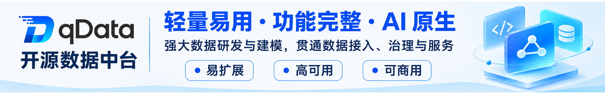

  
 
 
 
 

 
 
 

  📖简体中文 | <a href="README.md">📖English</a> | <a href="README.ja-JP.md">📖日本語</a>

## 平台简介

**轻量易用，功能完整，AI 原生。让个人轻松上手，让企业落地生产。**

qData 是一款面向企业数据团队与个人开发者的开源数据中台，集 **数据接入、数据研发、数据建模、数据治理、数据资产、API 数据服务与智能分析** 于一体，覆盖数据从接入、加工、组织、治理到共享应用的完整业务链路。

从个人开发与技术验证，到企业数据项目、日常研发与生产运维，qData 帮助个人完成真实的数据任务，帮助企业把数据能力用到实际业务中。

✨✨✨**在线文档**✨✨✨ <a href="https://docs.qdata.tech/qData/" target="_blank">https://docs.qdata.tech/qData/</a>

✨✨✨**开源版演示地址**✨✨✨ <a href="https://demo.qdata.tech" target="_blank">https://demo.qdata.tech</a> ，账号：`qData` 密码：`qData123`

✨✨✨**专业版演示地址**✨✨✨ <a href="https://pro-demo.qdata.tech" target="_blank">https://pro-demo.qdata.tech</a> ，演示账号请 [联系客服获取](https://docs.qdata.tech/business/policy.html)

> 如果 qData 对您有帮助，请点个 **Star ⭐️**，这是我们持续更新的最大动力！ 🚀

许可：Apache License 2.0 及 qData 附加条件，详见 [LICENSE](LICENSE) 与[商用说明](#license-and-services)。

## 核心特点

### 轻量易用：单机起步，按需扩展

提供 **轻量默认、企业扩展两种部署形态**。默认采用单实例 qData、单节点 SeaTunnel Zeta 与 DolphinScheduler Standalone，配合 MySQL、Redis 即可组织数据任务，无需先搭建一整套大数据集群。

### 强大数据研发：从数据同步到生产运维，一站贯通

贯通 **同步、开发、编排、调度与运维**，支持离线/实时、单表/整库同步及 **RDS SQL、Doris SQL、Shell 三类脚本开发**。结合模板复用、任务依赖、运行监控与失败重试，提升数据生产效率与运行可靠性。

### 强大数据建模：从业务规划到模型落地，全流程贯通

贯通业务规划、数仓分层、逻辑建模、指标定义与模型发布，实现从业务设计到模型落地。通过模型、指标与标准协同，统一数据结构和业务口径，提升模型复用与开发效率。

### AI 原生：面向数据全流程的智能协作

以自然语言交互、智能生成与辅助分析连接 **数据开发、任务配置、运行运维与数据分析**。智能问数支持 **Text2SQL、智能图表与文字洞察**，帮助用户高效查询、理解和使用数据。

### 功能完整：从数据接入到业务应用，全链路覆盖

统一组织数据生产、治理、资产管理与共享应用，配套项目空间、成员角色和系统管理。团队可以在同一平台连续完成数据的接入、加工、管理与使用。

### 易扩展：按业务增加能力，按规模扩展部署

采用模块化架构，支持数据源适配、业务模块、清洗与稽查规则的扩展和二次开发。通过 SQL、Shell 与模板复用业务逻辑，按任务规模扩展执行与调度组件。

### 高可用：支持多实例与集群部署，面向持续运行

支持 qData 多实例、SeaTunnel Zeta 分布式集群及 DolphinScheduler 集群，构建面向生产的运行环境。结合实例监控、运行日志、失败重试与同步恢复，让任务状态可观测、运行异常可处理。

## 快速开始

### 在线体验

访问 [qData 开源版演示环境](https://demo.qdata.tech)，无需安装即可了解产品。

**账号：`qData`　密码：`qData123`**

推荐先体验数据研发与数据建模，再查看数据资产、API 服务和智能问数，了解数据从生产到使用的完整过程。

### 选择部署方式

- **[Docker Compose 部署](https://docs.qdata.tech/qData/deploy/docker-compose-deployment.html)**：按文档配置并启动本地环境，适合快速体验与部署。
- **[源码启动](https://docs.qdata.tech/qData/deploy/build-from-source.html)**：启动前后端开发环境，开展二次开发与功能扩展。
- **[自主部署](https://docs.qdata.tech/qData/deploy/manual-deployment/)**：自行安装与管理服务，适合已有基础设施及个性化部署需求。

环境要求、安装步骤、组件配置与常见问题，统一查阅[部署指南](https://docs.qdata.tech/qData/deploy/deploy-open-source.html)。

## 产品功能架构

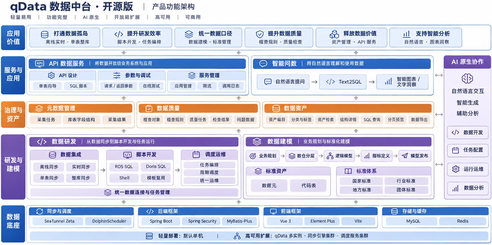

## 系统配图
<table>
    <tr>
        <td>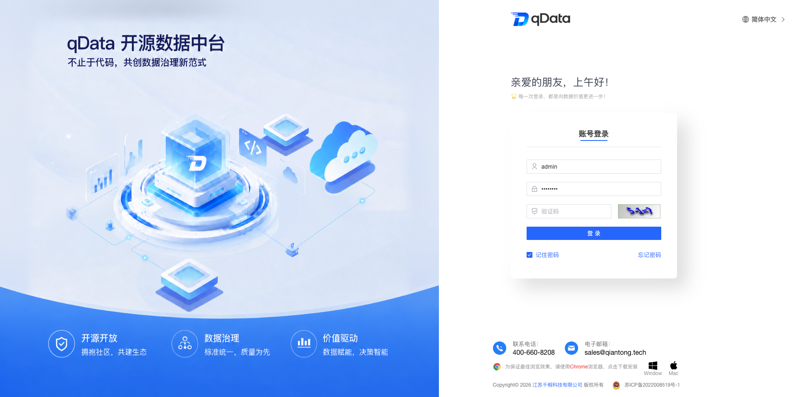</td>
        <td>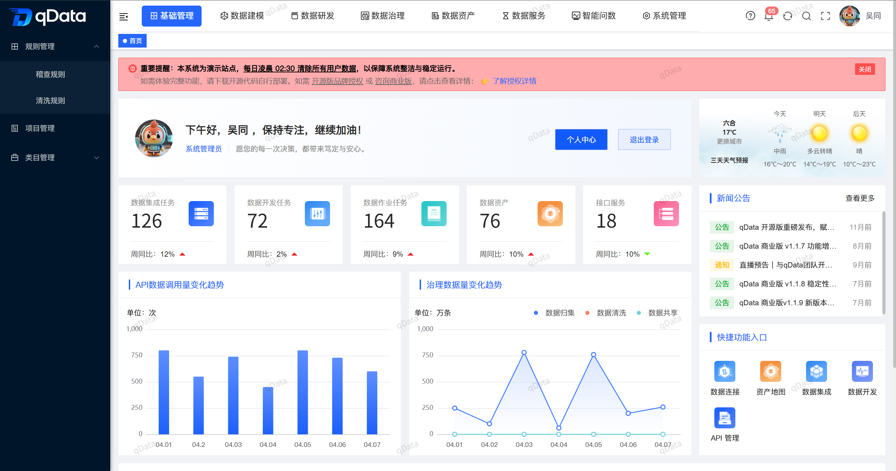</td>
    </tr>
    <tr>
        <td>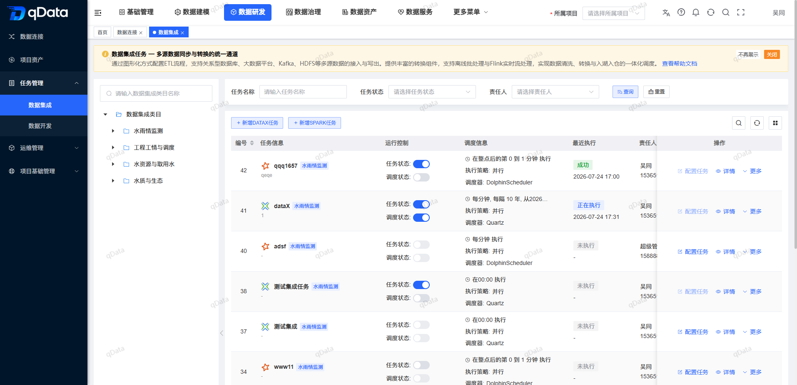</td>
        <td>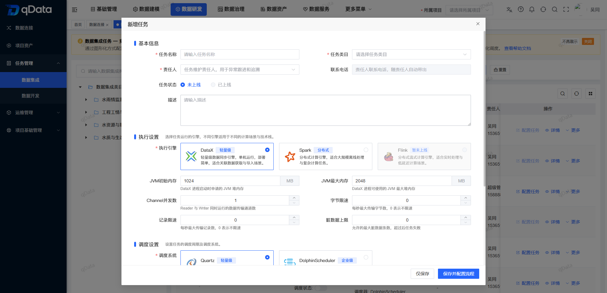</td>
    </tr>
    <tr>
        <td>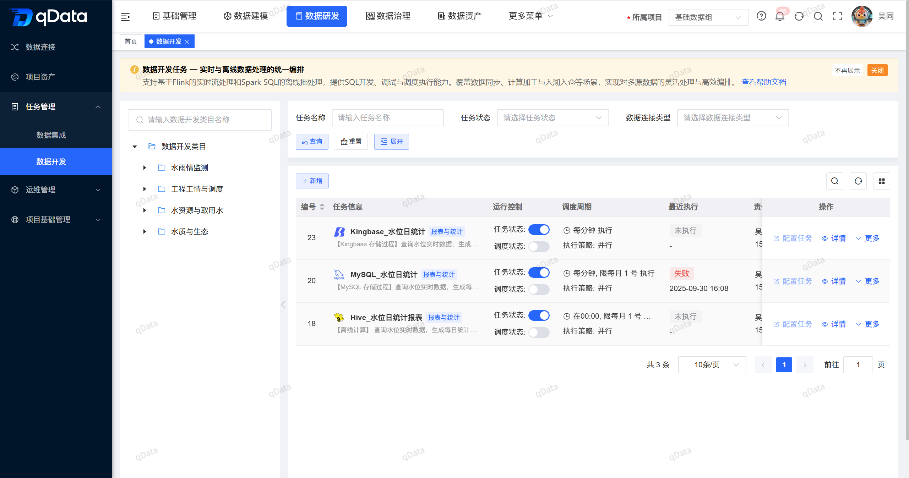</td>
        <td>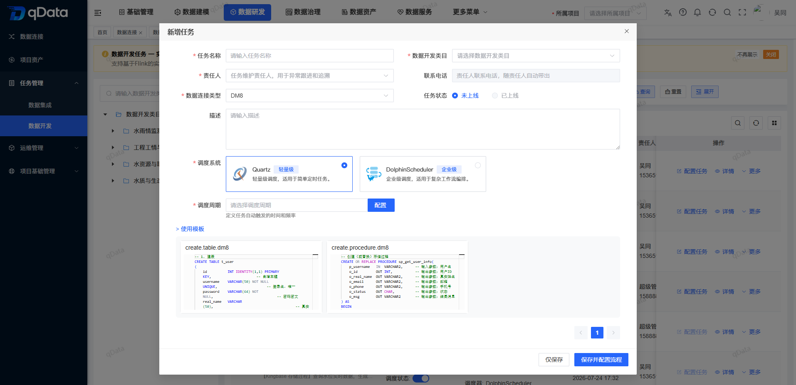</td>
    </tr>
    <tr>
        <td>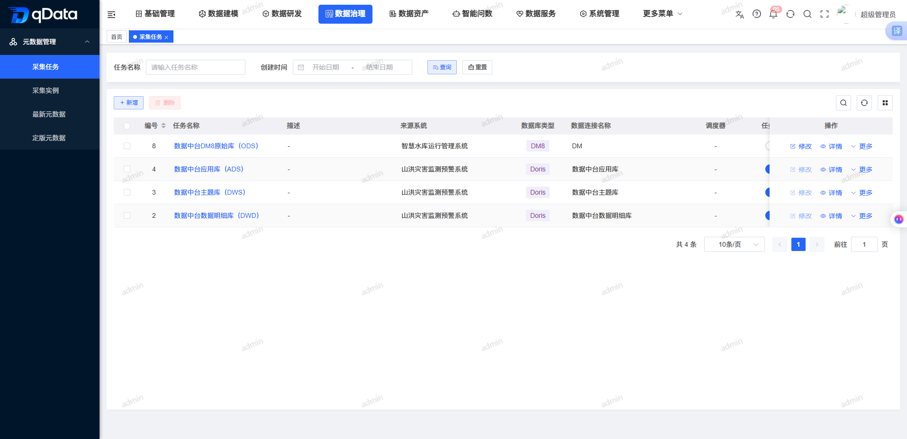</td>
        <td>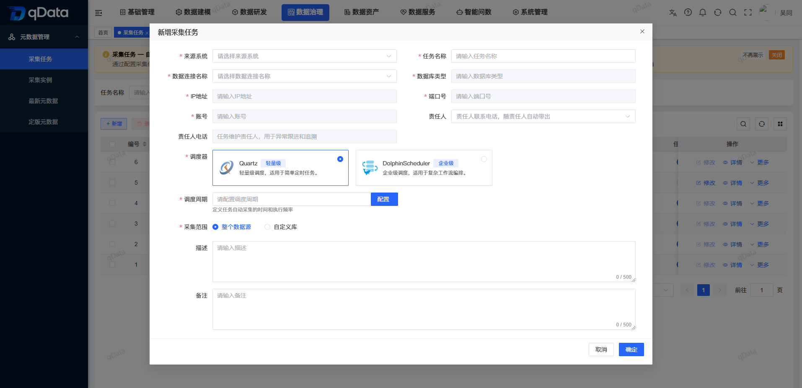</td>
    </tr>
    <tr>
        <td>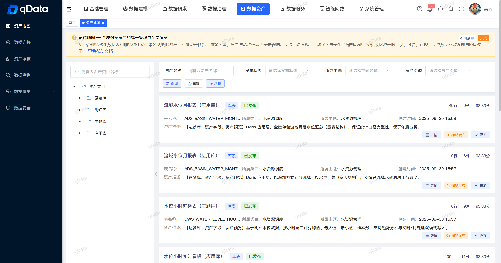</td>
        <td>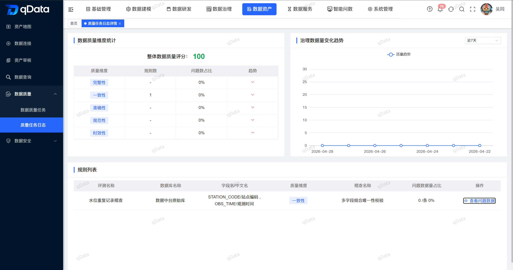</td>
    </tr>
    <tr>
        <td>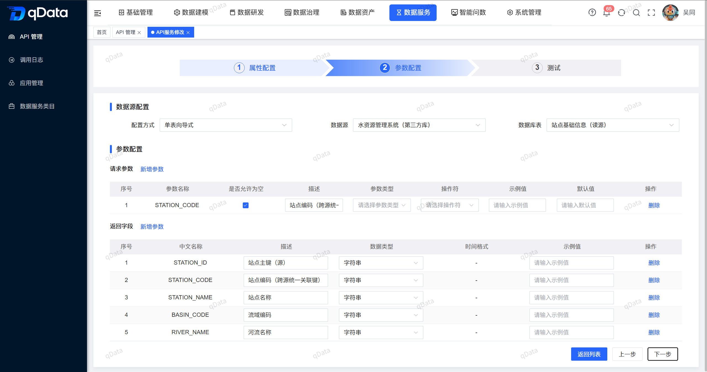</td>
        <td>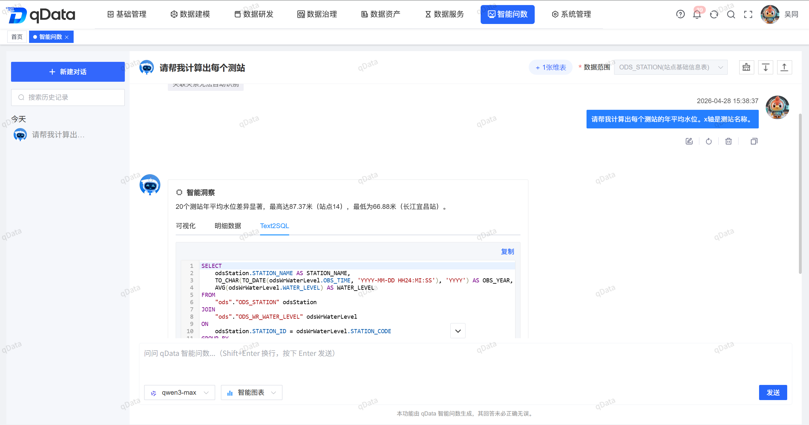</td>
    </tr>
</table>

## 能力概览

| 核心能力 | 能力亮点 |
| --- | --- |
| **30+ 种异构数据源** | 广泛兼容主流数据库、国产数据库、数据仓库、消息队列及文件存储，打破异构数据壁垒。 |
| **全场景数据集成** | 覆盖离线同步、实时 CDC、整库同步，支持全量、增量及跨库数据迁移，构建高效数据流转体系。 |
| **一站式数据研发** | 集 ETL、SQL 开发、DAG 工作流、Cron 调度、运行运维于一体，覆盖数据开发到生产运行全流程。 |
| **企业级数仓建模** | 支持 ODS、DIM、DWD、DWS、ADS 五层数仓架构，融合逻辑建模、指标体系与数据标准，构建规范化数仓体系。 |
| **全链路数据治理** | 深度融合元数据管理、数据标准、质量稽查与数据血缘，构建从数据发现到质量管控的治理闭环。 |
| **数据资产与服务开放** | 打通数据资产编目、智能检索、SQL 查询与 API 服务发布，实现数据资产化与服务化。 |
| **AI Agent 智能赋能** | 融合 AI 智能体、智能问数、AI 助手与智能研发辅助，支持自然语言交互、SQL 智能生成、图表分析与数据洞察，推动数据研发与分析智能化。 |

详细功能、支持的数据源与各版本的功能范围，请查看[功能对照表](https://docs.qdata.tech/qData/pro/features.html)。

## 轻量默认，企业级扩展

两种部署形态服务于不同的使用规模：个人开发、技术验证及日常数据任务可从轻量形态开始；企业可根据任务规模与可用性要求，扩展为多实例和集群部署。

| 组件 | 轻量默认形态 | 企业扩展形态 |
| --- | --- | --- |
| **qData** | 单实例 | 多实例，支持高可用扩展 |
| **SeaTunnel Zeta** | 单节点，执行数据同步任务 | 分布式集群，扩展任务执行能力 |
| **DolphinScheduler** | Standalone 单节点，统一任务调度 | 集群部署，扩展调度与任务执行能力 |
| **MySQL** | 存储平台运行数据 | 按生产要求配置数据库高可用方案 |
| **Redis** | 提供缓存服务 | 按生产要求配置缓存高可用方案 |
| **ZooKeeper** | 默认形态无需独立部署 | 按集群方案部署 |

Flink、Spark 等计算引擎可纳入扩展架构，按业务需要对接。具体任务开发类型与开放范围见[功能对照表](https://docs.qdata.tech/qData/pro/features.html)。

轻量化着重降低默认部署、资源使用和维护的负担；企业扩展着重提升运行规模与可用性。开发者可围绕同一平台，根据业务阶段选择合适的部署组合。

## 开发与扩展

qData 采用前后端分离与模块化设计，便于开发者理解代码、接入业务系统和扩展功能。

| 层次 | 主要技术 |
| --- | --- |
| 后端 | Spring Boot、Spring Security、MyBatis-Plus |
| 前端 | Vue 3、Element Plus、Vite |
| 默认同步与调度 | SeaTunnel Zeta、DolphinScheduler |
| 平台运行存储与缓存 | MySQL / 达梦8 二选一、Redis |
| 扩展计算引擎 | Flink、Spark 等按需接入的计算组件 |

可以从新增业务脚本、复用任务模板、扩展清洗与稽查规则开始，也可以进一步定制业务模块和数据源适配。开发环境与启动方式见[源码启动指南](https://docs.qdata.tech/qData/deploy/build-from-source.html)。

## QQ交流群
欢迎加入 qData 官方 QQ 交流群，获取最新动态、技术支持与使用交流。 👉 <a href="https://docs.qdata.tech/discuss.html">点击加入 QQ 交流群</a>

## 许可与商业服务

qData 按 **Apache License 2.0 及项目附加条件**提供，支持商业使用。使用时需遵守 [LICENSE](LICENSE)，保留其中要求的 Logo、版权、许可与署名信息。

如需去除或修改相关标识、白标、OEM 或重新包装为其他产品，请取得相应商业授权。品牌定制授权、专业版与技术服务咨询，请查看[商业合作说明](https://docs.qdata.tech/business/policy.html)。

## 我们的使命与愿景

**让每一位开发者、每一家企业，都能以可负担的成本掌握完整的数据能力。**

我们相信，数据平台应当让技术更易用，让数据更可信，让应用更容易落地。qData 以开源汇聚开发者的创造力，以 AI 降低数据工作的门槛，以完整、开放、可靠的产品承接真实业务，让个人的想法能够成为应用，让企业的数据能够持续创造价值。

我们希望与社区共同建设一个可以长期使用、持续扩展的数据基础平台，让更多人自主掌握数据，让更多创新从数据中发生。
